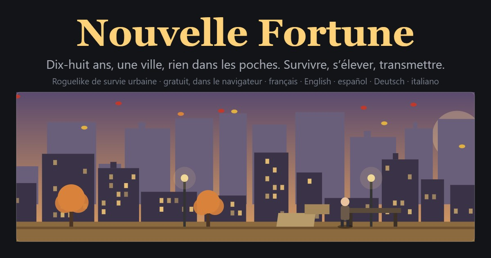

# Nouvelle Fortune

Un roguelike de survie urbaine au tour par tour, jouable dans le navigateur.
Vous avez 18 ans, vous vivez dans la rue d'une grande ville. Chaque tour est un
mois. Survivez, gravissez l'échelle sociale, fondez une famille, transmettez…
et recommencez avec un héritier, après des droits de succession volontairement
lourds.

**Jouer en ligne : <https://detectivepasteque-max.github.io/NewFortune/>**



Le jeu est jouable en **français, anglais, espagnol, allemand et italien**
(boutons sur l'écran titre).

Le jeu est écrit en HTML, CSS et JavaScript « classique » : **aucune
installation, aucun outil de compilation**. Tout le contenu (événements,
métiers, objets, recettes, logements, fiscalité, équilibrage) est dans des
fichiers de données lisibles et commentés, prévus pour être modifiés.

## Lancer le jeu

- **En local** : double-cliquez sur `index.html`. Ça suffit.
- **Avec un petit serveur** (pour reproduire un hébergement web) :
  `powershell -ExecutionPolicy Bypass -File outils\serveur-local.ps1 8765`
  puis ouvrez <http://localhost:8765/>.
- **Sur internet** : déposez tout le dossier tel quel sur n'importe quel
  hébergement statique (GitHub Pages, Netlify, OVH, un serveur Apache ou
  nginx…). Aucune configuration serveur n'est nécessaire.

La partie en cours, les bonus débloqués et les meilleurs scores sont sauvegardés
automatiquement dans le navigateur (localStorage). L'écran titre permet
d'exporter et d'importer sa sauvegarde en fichier JSON.

## Organisation des fichiers

```
index.html              page unique du jeu (liste tous les scripts, dans l'ordre)
css/style.css           feuille de style (couleurs dans :root)
lang/                   TRADUCTIONS : un dictionnaire par langue (en, es, de, it), voir docs/12-langues.md
data/                   TOUT LE CONTENU MODIFIABLE
  config.js             constantes d'équilibrage (jauges, usure, saisons, score…)
  actions.js            actions du joueur (mendier, fouiller, se laver…)
  competences.js        compétences (12 principales + 17 annexes : loisirs et talents)
  metiers.js            ~50 métiers en 5 niveaux (dont armée, gendarmerie, pompiers) et filières de promotion
  formations.js         formations et diplômes
  objets.js             objets, matériaux, consommables
  recettes.js           recettes de fabrication
  logements.js          logements et conditions d'accès
  classes.js            catégories sociales
  impots.js             impôt sur le revenu, succession, aides sociales
  entreprise.js         secteurs, statuts, financement
  traits.js             traits de caractère
  noms.js               prénoms, noms, origines
  ville.js              génération de la ville (quartiers, lieux)
  bonus.js              bonus permanents (méta-progression)
  succes.js             accomplissements
  evenements/           un fichier par famille d'événements
    systeme.js          événements déclenchés par le moteur (gardez les ids)
    sante.js, securite.js, social.js, administratif.js,
    travail.js, economie.js, famille.js,
    armee.js            carrière militaire et sécurité publique
    divers.js           vie quotidienne
    loisirs.js          loisirs et talents (événements ouverts par les compétences annexes)
    risques.js          risques mortels de la vie civile (route, chantier, froid, alcool, rixe…)
src/                    LE MOTEUR ET L'INTERFACE
  i18n.js               langues : NF.t('texte français') et choix de la langue
  nf.js                 espace de noms global NF + utilitaires
  compteurs.js          compteurs globaux de l'écran titre (joueurs, vies créées), via un service public
  core/                 règles du jeu (tour, économie, événements, famille…)
  ui/                   affichage (écran titre, écran de jeu, onglets, modales, scène)
  main.js               point d'entrée
docs/                   DOCUMENTATION (commencez par docs/00-sommaire.md)
outils/                 serveur local PowerShell, outil de simulation, outil de traduction (i18n.py)
```

## Modifier le jeu

Tout est expliqué dans le dossier `docs/` :

| Document | Contenu |
| --- | --- |
| `docs/00-sommaire.md` | Par où commencer |
| `docs/01-prise-en-main.md` | Lancer, héberger, dépanner |
| `docs/02-architecture.md` | Comment le code est organisé, l'état d'une partie, le tour |
| `docs/03-evenements.md` | Écrire un événement (conditions, choix, effets, chaînes) |
| `docs/04-metiers-formations.md` | Métiers, formations, aides sociales |
| `docs/05-objets-recettes.md` | Objets, effets passifs, recettes |
| `docs/06-actions.md` | Ajouter une action |
| `docs/07-logements-classes-fiscalite.md` | Logements, catégories sociales, impôts |
| `docs/08-famille-heritage-entreprise.md` | Famille, succession, entreprise |
| `docs/09-equilibrage.md` | Toutes les constantes, et comment tester |
| `docs/10-sauvegarde-meta.md` | Sauvegarde, score, bonus permanents |
| `docs/11-reference-api.md` | Référence des fonctions `NF.api` et `NF.core` |
| `docs/12-langues.md` | Traduire le jeu, ajouter une langue |

Règle d'or : **les identifiants (`id`) sont des chaînes sans accent ni espace,
uniques dans leur liste**. Pour ajouter du contenu, copiez une entrée existante,
changez son `id`, et rechargez la page. En cas d'erreur, ouvrez la console du
navigateur (F12) : le message indique le fichier et la ligne.

## Langues

Le code et les données sont écrits en français ; chaque texte affiché passe par
`NF.t('texte français')`, qui cherche la traduction dans `lang/<langue>.js` et
retombe sur le français si elle manque. Pour traduire un contenu que vous
ajoutez, ou ajouter une langue : `docs/12-langues.md` et `python outils/i18n.py`.

## Licence

Faites-en ce que vous voulez. Les textes et le code sont livrés sans garantie.
